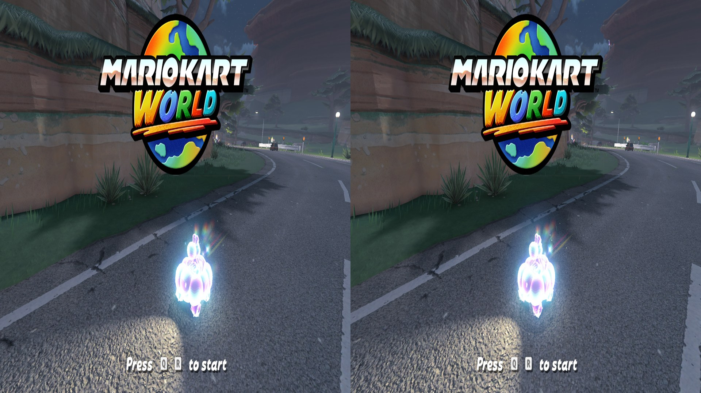
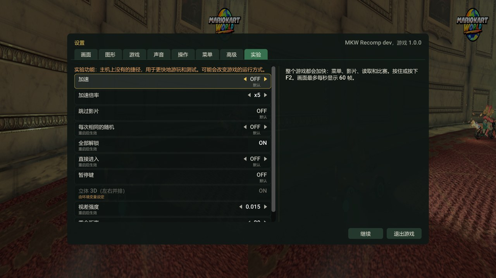

<h1 align="center">mkw-recomp-stereo</h1>

<p align="center">
  <b>A fork of <a href="https://github.com/adriadam10/mkw-recomp">adriadam10/mkw-recomp</a> that adds stereo 3D
  (left/right side by side) for SBS glasses.</b>
</p>

<p align="center">
  <b>English</b> · <a href="README.zh-CN.md">简体中文</a> · <a href="STEREO-3D.md">How it works</a>
</p>

> **What this repository is.** It is a derivative work of the upstream recompiler
> [adriadam10/mkw-recomp](https://github.com/adriadam10/mkw-recomp), taken at release **v0.1.11** and published under
> the same **MIT** license, within the terms that license grants. The recompiler, the NVN2-to-Vulkan layer, the SM86
> shader translator and everything else that makes the game run are the upstream project's work and remain theirs:
> all credit belongs there, and so do the issues that are not about stereo. This fork only adds the stereo mode
> described below, plus the small runtime hooks it needs.
>
> | | |
> |---|---|
> | Upstream | [adriadam10/mkw-recomp](https://github.com/adriadam10/mkw-recomp) (MIT, Copyright (c) 2026 Adrià) |
> | Based on | upstream **v0.1.11**, game versions 1.0.0 |
> | License | **MIT**, unchanged upstream `LICENSE`; the changes here are offered under the same terms |
> | Changes | stereo 3D: per-eye pipelines, SBS composition, SPIR-V shader injection, HUD/menu rows — see [STEREO-3D.md](STEREO-3D.md) |
> | Not included | any game code or data; no binaries or releases are published here |



*The frame the game presents: the left half is the left eye, the right half the right eye. The seam is where they
meet; the logo and other HUD elements are drawn flat (no parallax) so they cross it identically in both halves.*

## Status (2026-11): it works; the tuning window is narrow

With the shipped `SEP 0.015 / CONV 20` the pair carries real stereo — measured against the
formula below it is 26 px of disparity at 2 m, 16 px at 3 m, 8.6 px at 5 m, and zero at
`CONV` (20 m), which is the same order as a real 65 mm pair (≈32 px at 2 m). Lighting and
shadows match the mono build.

The failure mode is **over-separation**, not the direction of the shift. At `SEP 0.056` the
disparity is ~100 px at 2 m and at `SEP 0.30` it is ~350 px; the near geometry is then sheared
along x hard enough that surface orientation reads wrong and the shading appears to come from
the opposite side in one eye (the "two lights" artefact, reported at both settings). So the
usable window is roughly `SEP 0.010 – 0.025` with `CONV` at the main subject's distance, and
its upper end is set by when shading starts looking wrong.

One trap when verifying this yourself: matching the two halves over a *whole* window hides the
parallax. Background at ~`CONV` legitimately sits at 0 px and it holds far more pixels than the
subject, so a mean-absolute-difference search reports 0 px even when the subject is 20-30 px
apart. Measure on the subject, not on the frame.

Measurements, the shear formula and the limit analysis: [STEREO-3D.md](STEREO-3D.md#where-this-stands-tuning).

## Stereo 3D

Two views of the same scene, one per eye, presented side by side — for Xreal-style glasses in SBS mode, half the
width per eye. The shift is applied per eye in the vertex shaders, not faked from a depth buffer, so it is real
stereo: near objects get more separation than far ones.

* **`MKW_STEREO=1`** turns it on; **`MKW_SPIRV`** points at the injected shader directory (see below).
* **`MKW_STEREO_SEP`** — eye separation, in clip units (the shift an object at infinity gets).
* **`MKW_STEREO_CONV`** — the distance where the two eyes agree exactly: the zero-parallax plane. Objects nearer
  than `CONV` come forward, farther ones sink back. Set it *at* the subject and there is no depth at all; set it
  2x nearer or 2x farther and depth appears.
* Both are also rows in the in-game menu (**F1** or **Esc** → **Experiments**), together with the on/off switch.
  They take effect after a restart, because the values are baked into the shader modules when the pipelines are built.



Measured on an RTX 3070 Ti at 3840x2160: 45-60 fps, one frame per eye (16.7 ms apart at 60 fps), so a fast scene
shows a slight ghost; rendering both eyes from the same frame is future work. How it works, the numbers it was
verified with, and its limits: **[STEREO-3D.md](STEREO-3D.md)**.

## Deploying it

No binaries are published here: the pieces are copied onto an installation the upstream launcher has already set up,
and the shader set is built from **your own** game's shaders.

### 0. Get the game running first

Follow the [upstream playing instructions](https://github.com/adriadam10/mkw-recomp#playing): dump your own copy of
Mario Kart World 1.0.0, get the launcher from the
[upstream releases](https://github.com/adriadam10/mkw-recomp/releases), let it set the game up and check that it
plays. That leaves an installation folder with `mkw.exe`, `mkwgame.dll`, a **`spirv\`** folder of `.spv` files and
`mkw.ini`. **Do not go on until the mono build works.**

### 1. Build this fork

Use the `mkw.exe` built from this tree, or build it yourself with the upstream build system (Linux host, Docker for
the Windows cross-compile: [upstream building](https://github.com/adriadam10/mkw-recomp#building-from-source)). The
files this fork changes are listed in [NOTICE.md](NOTICE.md). The result is a single `mkw.exe`.

> The runtime only accepts the name **`mkw.exe`**: renamed, it crashes at startup. That is why the scripts below copy
> the build you want into `mkw.exe` instead of running it under another name.

### 2. Build the injected shader set from your own shaders

The shader programs on your machine are not the ones in this repository, so the parallax has to be injected into
*your* `spirv\` folder. Needs [SPIR-V Tools](https://github.com/KhronosGroup/SPIRV-Tools) — `spirv-dis`, `spirv-as`
and `spirv-val` on `PATH`.

Windows, in the installation folder:

```bat
xcopy /E /I /Y spirv spirv-mix2
python tools\stereo-inject\inject_par.py spirv spirv-mix2 8
```

Linux and macOS:

```sh
cp -r spirv spirv-mix2
python3 tools/stereo-inject/inject_par.py spirv spirv-mix2 8
```

It walks the copy, disassembles each vertex and mesh shader, inserts the shear (in front of the entry point's
`OpReturn` for a vertex shader, at each `gl_Position` store for a mesh shader), reassembles and validates it. 3,470 of
the 11,587 programs in a 1.0.0 installation get parallax — including the 18 mesh programs that draw characters,
karts and objects, which is what keeps their shadows in step with them; the rest stay mono, which is harmless. A
couple of minutes on 8 workers.

### 3. Drop in the stereo build and the two launchers

In the installation folder:

| File | |
|---|---|
| `mkw-official.exe` | your working mono build, renamed — kept as the fallback |
| `mkw-stereo.exe` | the build from step 1 |
| `spirv-mix2\` | the injected shaders from step 2 |

`play-stereo.bat`:

```bat
@echo off
cd /d "%~dp0"
copy /y "mkw-stereo.exe" "mkw.exe" >nul
set MKW_STEREO=1
set MKW_SPIRV=%~dp0spirv-mix2
start "" "mkw.exe"
```

`play-mono.bat`:

```bat
@echo off
cd /d "%~dp0"
copy /y "mkw-official.exe" "mkw.exe" >nul
start "" "mkw.exe"
```

Save both with **CRLF** line endings: a batch file written with bare LF breaks, because cmd reads a wrapped line as a
command of its own.

### 4. Tune it

Start `play-stereo.bat`, put the glasses in SBS mode (on an Xreal, hold **+** for two seconds), then open **F1** →
**Experiments**:

* **3D separation** — more is a stronger effect; too much and the eyes cannot fuse it. `0.015` is a good start.
* **3D convergence** — the distance of the main subject, and it is what makes the picture carry depth at all: leave
  it at `0` and every distance gets the same shift. `20` is a good start for a race, higher if near objects hurt.
* Both rows are marked *restart to apply*: close the game and run `play-stereo.bat` again. Only the on/off row reads
  *set by the environment* — that one comes from `MKW_STEREO` in the script.

If anything looks wrong, `play-mono.bat` gets you back to the ordinary picture.

## License, credit and scope of use

* **Same license as upstream: MIT.** `LICENSE` is the upstream file, unmodified: *Copyright (c) 2026 Adrià*. MIT
  permits use, copying, modification, merging, publishing, distribution and sublicensing, provided the copyright
  notice and the permission notice are kept — which is why that file stays as it is.
* **The changes in this fork** (stereo mode in `runtime/`, the menu rows, `tools/stereo-inject/`, the documents) are
  published by their authors under the same MIT terms, so they can be taken back upstream, reused, or relicensed by
  anyone who keeps the notice. See [NOTICE.md](NOTICE.md) for the file-by-file split.
* **No game content.** This repository, like upstream, contains no part of *Mario Kart World*: no executables, no
  RomFS, no keys. You need your own dump from your own console, exactly as upstream requires.
* **Not affiliated with Nintendo or with the upstream project.** Problems caused by the stereo mode belong here;
  everything else belongs upstream.

## Upstream documentation

Requirements, building from source, performance tables, the launcher, supported game versions, mods, the roadmap and
troubleshooting are upstream's and are kept there rather than copied here:

* **Repository and README:** <https://github.com/adriadam10/mkw-recomp>
* **Releases (the launcher):** <https://github.com/adriadam10/mkw-recomp/releases>
* **Issues and discussions:** <https://github.com/adriadam10/mkw-recomp/issues>
* **Docs in the source tree:** <https://github.com/adriadam10/mkw-recomp/tree/main/docs> — roadmap, performance,
  research and sources

中文说明：[README.zh-CN.md](README.zh-CN.md)
