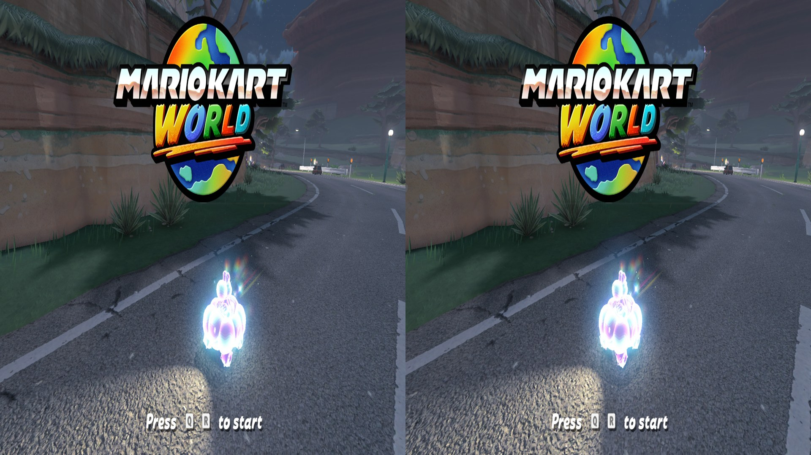
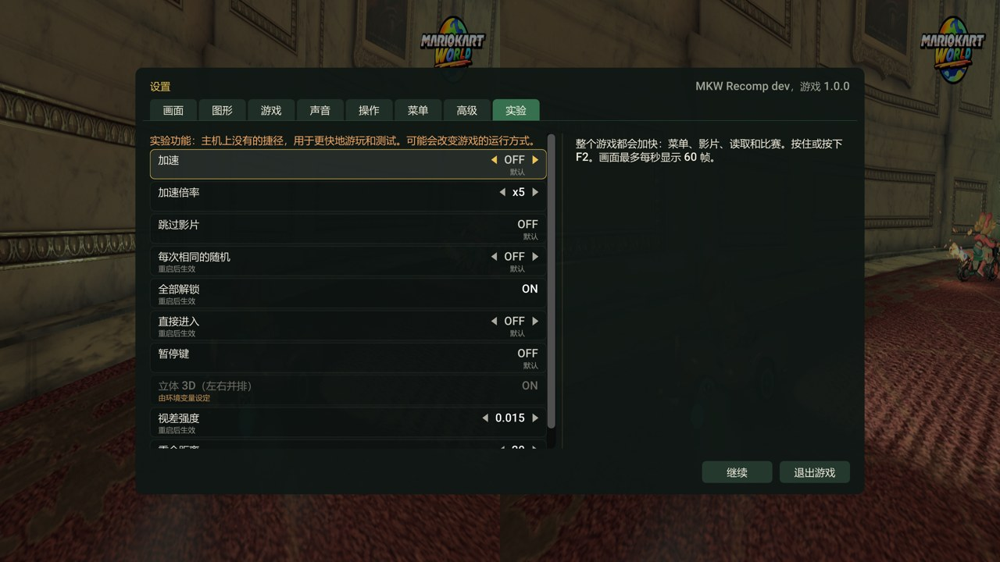

<h1 align="center">mkw-recomp-stereo</h1>

<p align="center">
  <b>在 <a href="https://github.com/adriadam10/mkw-recomp">adriadam10/mkw-recomp</a> 基础上增加立体 3D
  （左右并排）的分支，用于 SBS 眼镜。</b>
</p>

<p align="center">
  <a href="README.md">English</a> · <b>简体中文</b> · <a href="STEREO-3D.md">实现原理</a>
</p>

> **这个仓库是什么。** 它是对上游重编译项目 [adriadam10/mkw-recomp](https://github.com/adriadam10/mkw-recomp) 的
> 派生作品，取用上游 **v0.1.11** 版本，按上游 **MIT** 许可证的全部条款发布。重编译器、NVN2→Vulkan 图形层、SM86
> 着色器翻译器，以及让游戏跑起来的一切，都是上游的工作、也依然属于上游：功劳归于上游，与立体无关的问题也应报给
> 上游。本分支只增加了下面这一项立体模式，以及它所需的一点点运行时钩子。
>
> | | |
> |---|---|
> | 上游 | [adriadam10/mkw-recomp](https://github.com/adriadam10/mkw-recomp)（MIT，Copyright (c) 2026 Adrià） |
> | 基于 | 上游 **v0.1.11**，游戏版本 1.0.0 |
> | 许可证 | **MIT**，上游 `LICENSE` 一字未改；本分支的改动同样按此条款提供 |
> | 改动范围 | 立体 3D：分眼管线、SBS 合成、SPIR-V 着色器注入、菜单三行 —— 详见 [STEREO-3D.md](STEREO-3D.md) |
> | 不含 | 任何游戏代码或数据；本仓库不发布任何二进制与 Release |



*这就是程序输出的整帧：左半幅给左眼，右半幅给右眼，中间是接缝。Logo 和其余 HUD 元素按零视差平画，所以在两半里
位置完全一致、会横跨接缝，这是正常的。*

## 现状（2026-11）：可用，但参数窗口很窄

按发布默认值 `SEP 0.015 / CONV 20`，画面是**真实立体**：按下面的公式计算，2 m 处视差 26 px、3 m 处 16 px、
5 m 处 8.6 px、`CONV`（20 m）处为 0，与真实 65 mm 眼距（2 m 约 32 px）同一量级；光影与 mono 版一致。

失效方式是**分离度过大**，不是位移方向错。`SEP 0.056` 时 2 m 处约 100 px、`SEP 0.30` 时约 350 px，近距离几何
被沿 x 方向剪切到表面朝向都读错了，明暗就会看起来来自相反一侧（即“两个光源”，在这两个取值上都出现过，0.015
上没有）。可用窗口大致是 `SEP 0.010 – 0.025`，上限取决于“光影开始显得别扭”的那一点。

自己验证时有一个坑：在**整块画面**上找两眼最佳对齐会得到 0 px。靠近 `CONV` 的背景（地面、远景）本来就该是 0 px，
而它的像素远多于主体，平均绝对差最小化会被它拉回 0。**要在主体上量，不要在整帧上量。**

公式推导、视差表与上限分析见 [STEREO-3D.md](STEREO-3D.md#where-this-stands-tuning)。

## 立体 3D

同一场景的两份视图，一眼一份，左右并排显示——供 Xreal 类眼镜的 SBS 模式使用，每眼占半幅。视差是在顶点着色器里分眼
施加的，不是从深度缓冲伪造的，因此是真正的立体：近处物体视差大、远处小。

* **`MKW_STEREO=1`** 开启立体；**`MKW_SPIRV`** 指向注入后的着色器目录（见下）。
* **`MKW_STEREO_SEP`** —— 眼距，单位是裁剪空间（相当于无穷远物体得到的位移量）。
* **`MKW_STEREO_CONV`** —— 重合距离，即两眼完全对齐的那个距离（零视差面）。近于 `CONV` 的物体前凸、远于它的后退。
  把它设在被摄体上就完全没有纵深；设成被摄体距离的一半或两倍，纵深就出现。
* 这两项在游戏内菜单里也有（**F1** 或 **Esc** → **实验** 页），连同总开关。它们**重启后生效**——数值在建管线时
  被烧进着色器模块里。



在 RTX 3070 Ti、3840×2160 上实测 45~60 fps。左右眼各用一帧（60 fps 下相差 16.7 ms），因此快速运动场景会有轻微重影；
两眼同帧渲染属后续工作。实现原理、验证数据与已知限制见 **[STEREO-3D.md](STEREO-3D.md)**。

## 部署方式

本仓库不发布二进制。所有文件都是叠加到**上游启动器已经装好**的游戏目录上的；着色器集必须从**你自己**游戏里的着色器
生成。

### 0. 先把原版跑起来

按[上游的玩法说明](https://github.com/adriadam10/mkw-recomp#playing)操作：dump 自己的《马力欧卡丁车世界》1.0.0，
从[上游 Releases](https://github.com/adriadam10/mkw-recomp/releases) 下载启动器，让它完成安装并确认能正常游戏。
完成后安装目录里有 `mkw.exe`、`mkwgame.dll`、**`spirv\`** 文件夹（一堆 `.spv`）和 `mkw.ini`。
**原版跑不通就先别往下走。**

### 1. 得到本分支的 `mkw.exe`

直接用从本仓库编译出来的 `mkw.exe`，或用上游的构建系统自己编（Linux 宿主，Windows 交叉编译走 Docker，见
[上游构建说明](https://github.com/adriadam10/mkw-recomp#building-from-source)）。本分支改了哪些文件列在
[NOTICE.md](NOTICE.md) 里。产物就是一个 `mkw.exe`。

> 运行时**只认 `mkw.exe` 这个文件名**，改名会在启动时崩溃。所以下面的脚本是把你想要的那一版 `copy` 成 `mkw.exe`
> 再启动，而不是换个名字直接运行。

### 2. 用你自己的着色器生成注入集

你机器上的着色器和本仓库里的不是同一批，所以视差必须注入到**你自己的** `spirv\` 里。需要
[SPIR-V Tools](https://github.com/KhronosGroup/SPIRV-Tools)，即 `spirv-dis`、`spirv-as`、`spirv-val` 在 `PATH` 上。

Windows，在安装目录内：

```bat
xcopy /E /I /Y spirv spirv-mix2
python tools\stereo-inject\inject_par.py spirv spirv-mix2 8
```

Linux / macOS：

```sh
cp -r spirv spirv-mix2
python3 tools/stereo-inject/inject_par.py spirv spirv-mix2 8
```

脚本会遍历副本，把每个顶点着色器和网格着色器反汇编，插入位移算式（顶点着色器插在入口 `OpReturn` 之前，网格着色器
插在每处 `gl_Position` 写入处），再汇编回去并校验。1.0.0 版本的 11,587 个程序里 3,470 个会获得视差——其中包含绘制
人物、车辆和物体的 18 个网格着色器，它们的视差是影子能和物体对上的关键；其余保持单色（不影响使用）。8 进程约需几分钟。

### 3. 放入立体版和两个启动脚本

安装目录里：

| 文件 | |
|---|---|
| `mkw-official.exe` | 你原本能跑的原版，改名留着作为退路 |
| `mkw-stereo.exe` | 第 1 步得到的立体版 |
| `spirv-mix2\` | 第 2 步生成的注入着色器集 |

`play-stereo.bat`：

```bat
@echo off
cd /d "%~dp0"
copy /y "mkw-stereo.exe" "mkw.exe" >nul
set MKW_STEREO=1
set MKW_SPIRV=%~dp0spirv-mix2
start "" "mkw.exe"
```

`play-mono.bat`：

```bat
@echo off
cd /d "%~dp0"
copy /y "mkw-official.exe" "mkw.exe" >nul
start "" "mkw.exe"
```

两个文件都要存成 **CRLF** 换行：用纯 LF 写的批处理会出错，因为 cmd 会把被折断的一行当成独立命令执行。

### 4. 调参

运行 `play-stereo.bat`，把眼镜切到 SBS 模式（Xreal 上长按 **+** 两秒），然后按 **F1** → **实验**：

* **3D 视差强度** —— 越大越明显，过大双眼会合不上。建议从 `0.015` 起。
* **3D 重合距离** —— 主要对象的距离，画面有没有纵深全靠它：留在 `0` 等于所有距离同一位移、没有立体感。比赛场景建议
  从 `20` 起，近处物体看着难受就调大。
* 这两行都标着“重启后生效”：关掉游戏，再运行一次 `play-stereo.bat`。只有开关那一行显示“由环境变量设定”，它来自脚本
  里的 `MKW_STEREO`。

出问题就用 `play-mono.bat` 回到普通画面。

## 授权、署名与使用范围

* **与上游同一许可证：MIT。** `LICENSE` 就是上游那份文件，未做任何修改：*Copyright (c) 2026 Adrià*。MIT 允许使用、
  复制、修改、合并、发布、再分发与再许可，条件只是保留版权声明与许可声明——所以那个文件保持原样。
* **本分支的改动**（`runtime/` 里的立体部分、菜单三行、`tools/stereo-inject/`、文档）由本分支作者按同样的 MIT
  条款发布，可以回灌上游、可以再被任何人使用或再许可，只要保留声明。逐文件的归属划分见 [NOTICE.md](NOTICE.md)。
* **不含游戏内容。** 本仓库与上游一样，不包含《马力欧卡丁车世界》的任何部分：没有可执行文件、没有 RomFS、没有密钥。
  和上游要求一致，你必须使用从自己主机 dump 出来的游戏。
* **与任天堂、与上游项目均无隶属关系。** 立体模式引起的问题报给本仓库，其余问题报给上游。

## 上游文档

需求、从源码构建、性能表、启动器、支持的游戏版本、Mod、路线图与排错，都是上游的内容，**只给链接、不在此复制**：

* **仓库与 README：** <https://github.com/adriadam10/mkw-recomp>
* **Releases（启动器）：** <https://github.com/adriadam10/mkw-recomp/releases>
* **Issues 与 Discussions：** <https://github.com/adriadam10/mkw-recomp/issues>
* **源码内文档：** <https://github.com/adriadam10/mkw-recomp/tree/main/docs> —— 路线图、性能、调研与来源

English: [README.md](README.md)
